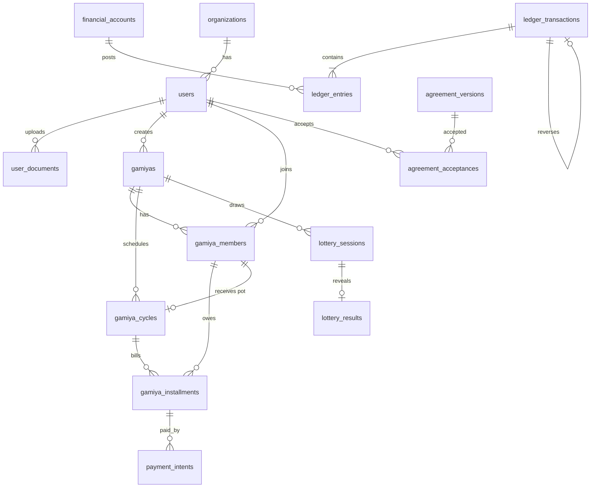

# DATABASE SCHEMA (migration 001 — النواة)

الملف المنفّذ: `infrastructure/database/migrations/001_core.sql` — مُختبر على PostgreSQL 16 (انظر TESTING_REPORT.md).
الجداول الباقية من PART 9 (الإشعارات، AI، الاشتراكات، النزاعات...) مجدولة في migrations لاحقة.

## القيود المفروضة في قاعدة البيانات
| القيد | الآلية |
|---|---|
| عدد الدورات = عدد الأعضاء | `CHECK cycles_equal_members` |
| دور قبض واحد لكل عضو، وعضو واحد لكل دور | `UNIQUE (gamiya_id, payout_position)` |
| توازن القيد المزدوج | `CONSTRAINT TRIGGER ledger_balanced` (مؤجل لنهاية المعاملة) |
| عدم تعديل/حذف السجلات المالية والتدقيق | `forbid_mutation()` triggers |
| منع تكرار المعاملة | `UNIQUE idempotency_key` |
| منع إعادة Webhook | `UNIQUE (provider, provider_event_id)` |
| قرعة رسمية واحدة لكل جمعية | partial unique index |
| البذرة تطابق الالتزام | trigger `check_lottery_seed` (pgcrypto sha256) |
| Maker–Checker للقرعة | `CHECK executed_by <> approved_by` |
| المبالغ | `numeric(18,2)`؛ التواريخ `timestamptz` (UTC) |
