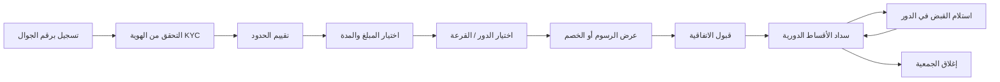

# تقرير الهندسة العكسية الوظيفية — المرجع: Money Fellows

> أُعدّ باستخدام مهارة **إعادة استنساخ التطبيقات** (المبنية على REA v6.8.0) — بتاريخ 2026-11-09.

## 1. نطاق التحليل وحالة التصريح

| البند | القيمة |
|---|---|
| الهدف | Money Fellows — تطبيق جمعيات رقمية (مصر) |
| المصادر | الصفحات العامة فقط: من نحن، كيف تنضم، الشروط والأحكام |
| حالة التصريح | **لا يوجد تصريح** بفحص تطبيق الطرف الثالث أو واجهاته الخلفية |
| ما لم يُنفَّذ عمداً | تفكيك ملف APK/IPA، التقاط حركة الشبكة، تحليل حزم JavaScript، أي تجاوز لمصادقة |
| السبب | بوابة المشروعية في المهارة + PART 12 من البرومت: لا ادعاء لكود داخلي أو API دون وصول مشروع |
| أسلوب البناء | غرفة نظيفة: مواصفات بكلماتنا، اسم وهوية وتصميم ونصوص أصلية |

تصنيف الأدلة: **VERIFIED** (منصوص في صفحة عامة) · **INFERRED** (استنتاج هندسي) · **UNKNOWN** · **REQUIRES_TEST**.

## 2. خريطة الوظائف المرصودة

| # | الوظيفة | التصنيف | الدليل / الملاحظة | قرارنا في Smart Gam'eya |
|---|---|---|---|---|
| F1 | رقمنة الجمعية التقليدية (دوّارة ادخار) | VERIFIED | صفحة من نحن | نواة المنتج |
| F2 | اختيار مبلغ القبض ثم المدة (6/10/12 شهراً) | VERIFIED | صفحة كيف تنضم | مدة = عدد الأعضاء × الدورية؛ قيم قابلة للضبط |
| F3 | العضو **يختار** دوره في القبض | VERIFIED | كيف تنضم | ندعم الاختيار + القرعة الموثّقة + المختلط (PART 5.5) |
| F4 | رسوم إدارية للأدوار المبكرة تتناقص حتى صفر، وخصم للأدوار الأخيرة | VERIFIED | كيف تنضم (سقف معلن 16%) | `fees.ts`: سياسة bps قابلة للضبط وسقف إلزامي — **تتطلب مراجعة شرعية/قانونية** |
| F5 | توزيع الرسوم بالتساوي على الأقساط حتى شهر القبض | VERIFIED | مثال رقمي في الصفحة | منفّذ في `computeFeePlan` ومُختبر |
| F6 | حدود ائتمانية آلية حسب تحليل بيانات العميل | VERIFIED (وجودها) / UNKNOWN (الخوارزمية) | كيف تنضم + الشروط | محرك مخاطر قابل للتفسير وغير تمييزي، دون رفض آلي غير قابل للمراجعة |
| F7 | التحقق من الهوية (بطاقة وجهان، فاتورة مرافق، بيانات دخل) | VERIFIED | الشروط | KYC سعودي: هوية/إقامة + نفاذ عند الاعتماد قانونياً |
| F8 | عقد قانوني يُوقّع قبل البدء ويُسلّم للعنوان | VERIFIED | كيف تنضم | اتفاقيات إلكترونية بإصدارات وبصمة Hash؛ التوقيع المعتمد REQUIRES_TEST قانونياً |
| F9 | الشركة تغطي أدوار المتعثرين ليصل القبض كاملاً | VERIFIED (ادعاء) | كيف تنضم | **لا ننفذه في MVP**: يعني تحمّل مخاطر ائتمانية = نشاط تمويلي منظّم |
| F10 | غرامة تأخير حتى 1% أسبوعياً وتسريع المستحقات | VERIFIED | الشروط | **مستبعد**: غرامات التأخير النقدية تثير إشكالاً شرعياً ونظامياً؛ نعتمد سياسة معلنة غير ربوية |
| F11 | لا انسحاب بعد الانضمام | VERIFIED | الشروط | سياسة انسحاب قابلة للضبط مع استبدال عضو من قائمة انتظار |
| F12 | حد أقصى لعدد الجمعيات المتزامنة ومجموع المبالغ | VERIFIED | الشروط | حدود قابلة للضبط من لوحة الإدارة |
| F13 | طرق دفع متعددة واستقطاع من الراتب | VERIFIED | كيف تنضم + الشروط | Payment Provider Abstraction (مدى، Apple Pay، SADAD عبر مزود مرخص) |
| F14 | دعوة صديق وخصم للطرفين | VERIFIED (قيم متضاربة في الصفحة) | كيف تنضم | نظام إحالة قابل للضبط |
| F15 | بطاقة مسبقة الدفع مع ماستركارد وكاش باك | VERIFIED | من نحن | خارج النطاق (يتطلب إصدار أدوات دفع مرخص) |
| F16 | العمل تحت البيئة التجريبية للبنك المركزي المصري | VERIFIED | من نحن | المكافئ السعودي: البيئة التجريبية لساما — انظر COMPLIANCE_ASSESSMENT |
| F17 | عملاء الشركات (خصومات، أدوار مبكرة) | VERIFIED | كيف تنضم | خطة Business في PART 15 |
| F18 | آلية تخصيص الأدوار عند التنافس على نفس الدور | UNKNOWN | غير موضح | نصمم: قرعة موثقة بين المتنافسين |
| F19 | بنية الخادم وقاعدة البيانات | UNKNOWN | لا وصول مشروع | تصميم أصلي (SYSTEM_ARCHITECTURE.md) |

## 3. رحلة المستخدم المستنتجة (INFERRED من الصفحات العامة)

## 4. الفروق الجوهرية عن المرجع (تصميمنا)

1. **الجمعيات بين أشخاص يعرفون بعضهم أولاً** (دعوات خاصة) قبل المطابقة مع غرباء — يقلّل مخاطر التعثر والمتطلبات التنظيمية في البداية.
2. **قرعة قابلة للتحقق علناً** (commit–reveal) بدلاً من تخصيص غير شفاف.
3. **لا غرامات تأخير ربوية، ولا ضمان من المنصة** في MVP.
4. **المنصة لا تحتفظ بالأموال**: التحصيل والتوزيع عبر مزود مرخص فقط بعد اعتماد المسار القانوني.

## 5. الفجوات المفتوحة

- UNKNOWN: آلية الإسناد عند التعارض، نموذج الحدود الائتمانية، طريقة صرف القبض.
- REQUIRES_TEST: قبول سوق السعودية لنموذج الرسوم حسب الدور؛ قبول ساما للنموذج.

## المصادر

- https://moneyfellows.com/ar-eg/about-us-page/
- https://moneyfellows.com/ar-us/how-it-works/
- https://moneyfellows.com/ar-eg/terms-and-conditions
