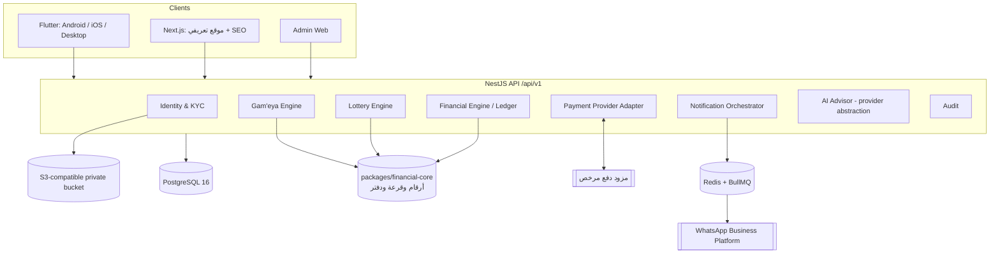

# SYSTEM ARCHITECTURE

## القرار: Modular Monolith (NestJS) + PostgreSQL + Redis/BullMQ
مبرر: فريق صغير، معاملات مالية تحتاج ACID في قاعدة واحدة، لا مبرر حالي لـ Microservices (PART 4).



## مبادئ حاكمة
1. **مصدر الحقيقة للأرقام = financial-core + قاعدة البيانات.** الذكاء الاصطناعي يقرأ فقط ويصيغ؛ لا يولد مبالغ أو مواعيد أو نتائج قرعة.
2. **قرعة commit–reveal**: الالتزام يُنشر قبل القرعة، البذرة تُكشف بعدها، قاعدة البيانات ترفض أي بذرة لا تطابق الالتزام.
3. **Webhooks هي الحقيقة للدفع**: تحقق التوقيع، فهرس فريد على `provider_event_id` ضد الإعادة، idempotency keys على كل عملية.
4. **Append-only**: الدفتر، نتائج القرعة، قبول الاتفاقيات، سجل التدقيق — محمية بـ triggers.
5. **Jobs**: idempotent، قابلة لإعادة المحاولة، بأقفال موزعة، وتوقيت الخادم فقط.

## Monorepo
```
apps/{api,web,admin,mobile}     # Phase 2+
packages/financial-core         # ✅ منفّذ ومختبر
packages/{shared-types,design-system,api-client,ai-core,notification-core}
infrastructure/database         # ✅ migration 001 + اختبارات SQL
docs/  agents/  tests/
```
